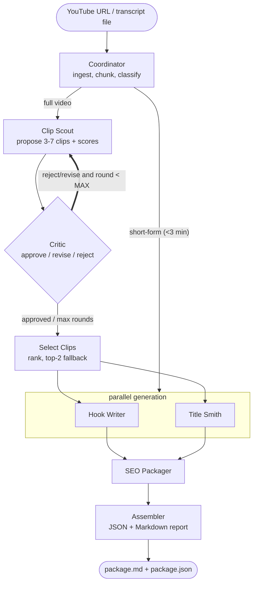

# Content Repurposing Agent

Takes a YouTube URL (or a transcript file) and turns it into a ready-to-use content package: ranked Shorts/Reels clips, hooks, titles, thumbnail text and SEO copy. It is a small team of LLM agents built with LangGraph, with a critic step that reviews the clip picks and sends weak ones back for another try.

Stack: LangGraph, FastAPI, Groq, Langfuse for tracing, SQLite for the job store. I built it for my own YouTube channel (Alpha Zone, football + AI) to stop cutting clips and writing titles by hand.

## How it works

The main idea is a critique loop with conditional routing, instead of a straight prompt chain.

- The Clip Scout proposes 3 to 7 clips and scores each on hook potential, completeness and shareability.
- The Critic checks every pick against fixed criteria and returns approve, revise or reject.
- Rejected or revised picks go back to the Clip Scout along with the feedback. This repeats for at most 2 rounds.
- The Coordinator decides the route. A video shorter than 3 minutes skips clip selection completely.
- The final report also lists which clips were rejected and why.



The thick edge from Critic back to Clip Scout is the loop. In Langfuse it shows up as repeated spans in the same trace.

## Output

Each run writes `outputs/{video_id}/package.md` and `package.json`.

- Clips with timestamp ranges, the reason each was picked, and scores
- 3 hooks per clip (curiosity, bold claim, question), 12 words max
- 5 titles for the main video and 3 per clip, 60 characters max
- 2 to 4 word ALL-CAPS thumbnail text per clip
- Video description with chapter timestamps, up to 15 tags, up to 8 hashtags, plus Shorts and Reels captions
- Rejected clips with the Critic's reasons, and a cost summary for the job

<details>
<summary>Example output (from a 3Blue1Brown video)</summary>

```markdown
# Content Package - aircAruvnKk
Duration: 18:26 | Clips: 3 approved / 6 proposed (2 critique rounds)

## Main Video Titles
- Unlocking Neural Networks for Handwritten Digits
- How Neural Networks Recognize Handwritten Digits
- The Power of Neural Networks in Digit Recognition

### #1 | 06:22-07:14 (52s) | score 24/30
> Recognizing a loop can also break down into subproblems. One reasonable way
> to do this would be to first recognize the various little edges that make it up.
Why: Clear explanation of loop recognition

Hooks:
- curiosity: Breaking down loops into subproblems can be a game changer
- bold_claim: Recognizing loops is key to solving complex problems
- question: How do we break down complex loops into simpler parts

Thumbnail text: EDGE DETECTION | LOOP RECOGNITION | SUBPROBLEMS
```
</details>

## Setup

### Local

```bash
python3.12 -m venv .venv && source .venv/bin/activate   # 3.12 works best with LangGraph
pip install -r requirements.txt
cp .env.example .env
# put your Groq key in .env: LLM_API_KEY=gsk_...  (free at https://console.groq.com/keys)

uvicorn app.main:app --reload
```

Open http://localhost:8000 for the web UI. Paste a URL, watch the pipeline run, and copy the description, tags and captions with one click.

You can also hit the API directly:

```bash
# submit a video
curl -X POST localhost:8000/process -H 'content-type: application/json' \
  -d '{"video_url":"https://www.youtube.com/watch?v=<id>"}'
# -> {"job_id":"job_...","status":"queued"}

curl localhost:8000/jobs/job_...      # poll until status is "done"
curl localhost:8000/stats             # approval rate, cost per video, videos processed
open outputs/<video_id>/package.md    # the report you actually use
```

To use a transcript file instead of a URL:

```bash
curl -X POST localhost:8000/process -F "file=@transcript.srt"
```

### Docker

```bash
docker build -t content-agent .
docker run -p 8000:8000 -e LLM_API_KEY=gsk_... content-agent
```

## Evaluation

I mark the best clips of my own videos by hand and check how many of them the agent finds.

```bash
python evals/run_evals.py    # recall, precision, critic on/off comparison, LLM-judge scores
```

Current scorecard (the golden set is still a placeholder, so treat the numbers as a demo of the setup, not as a result):

```
fixture            rec ON  rec OFF  prec ON  prec OFF   clips ON/OFF
--------------------------------------------------------------------------
AVERAGE              38%      62%      35%       33%
--------------------------------------------------------------------------
LLM-as-judge (avg 1-10): hook truthfulness 8.0 | title truthfulness 9.0 | title CTR 8.0
```

About the critic on/off comparison: recall goes down with the critic on (62% to 38%), but that mostly comes from how the metric works. With the critic off the agent keeps 6 clips, with it on only 2 to 5, so the critic-off run covers more ground by default. Precision goes up slightly with the critic (33% to 35%), which is the more relevant number since the critic is meant to trade quantity for quality. To get numbers that mean something, fill `evals/golden_set.json` with your own marks.

## Design notes

- Why a critic loop: a single pass has no way to catch its own weak picks. The on/off comparison lets me measure what the critic changes instead of assuming it helps.
- Structured outputs: every agent returns a Pydantic object through `with_structured_output`, so there is no regex parsing of free text. Timestamps are also validated in code against the transcript bounds (clips are clamped to 15-75s), so a made-up timestamp cannot reach the output.
- Failure handling: each node is wrapped, so if one agent fails the error is recorded and the pipeline still finishes. For rate limits, the LLM layer separates a daily cap (cool that model down and fall back to a smaller one) from a short per-minute spike (sleep briefly and retry the same model). This keeps long videos from being pushed onto a model that cannot fit them. Over-length outputs are trimmed by guardrails.
- Long videos: the Clip Scout splits the transcript into chunks that fit the free-tier per-request limit, finds the best clips in each chunk (map), then keeps the best overall (reduce). It works for videos up to about 1.5 to 2 hours, and I tested it on a 1h56m video where the clips came from the whole runtime.
- Cost and tracing: each job is one Langfuse trace with one span per agent. Token usage is summed across all attempts and stored in SQLite, which is what `/stats` reads.

## Endpoints

| Method | Path | Purpose |
|--------|------|---------|
| GET | `/` | Web UI |
| GET | `/health` | Liveness and config |
| POST | `/process` | Start a job (JSON `{video_url}` or multipart file). Completed URLs are deduped. |
| GET | `/jobs/{id}` | Job status, and the full package when done |
| GET | `/stats` | Videos processed, approval/rejection rate, average cost per video |

## Deployment

The Dockerfile binds to `$PORT`, so it can be deployed as is on Render, Fly.io, Cloud Run or Hugging Face Spaces. Set `LLM_API_KEY` (and the Langfuse keys, if you use them) as environment variables in the host.

One thing to know: YouTube blocks or throttles requests from datacenter IPs, so fetching a transcript by URL usually fails on a hosted server with an `IpBlocked` error. There are two ways around it:

1. Upload a transcript file (`.srt`, `.txt` or `.json`) instead. This does not touch YouTube at all, so it works anywhere.
2. Use a proxy. The fetcher reads `YOUTUBE_PROXY_USERNAME` and `YOUTUBE_PROXY_PASSWORD` (Webshare) or `YOUTUBE_HTTP_PROXY`, which makes URL fetching work from the cloud.

When running on your own machine (a normal home IP), neither is needed.

## Tech stack

Python 3.12, LangGraph, LangChain, Groq (`llama-3.3-70b-versatile`, free tier), FastAPI, Pydantic v2, youtube-transcript-api, yt-dlp, Langfuse, SQLite, pytest, Docker

More on the graph internals, the critique loop, routing and failure handling is in [architecture.md](architecture.md).
